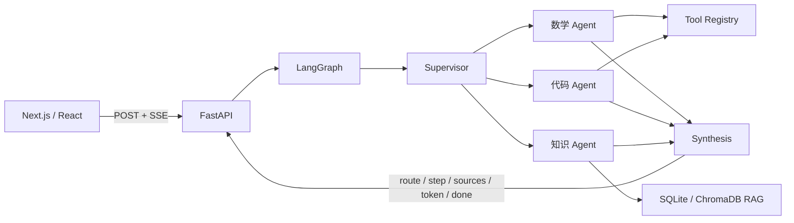

# Nexus Agent 多 Agent 智能对话平台

一个可以直接运行的全栈 AI Agent 项目，对应简历中的“基于 LangGraph 的多 Agent 协作、工具调用、RAG 知识库与 SSE 流式对话”项目。

项目默认使用本地演示引擎，不需要 API Key 就能完整体验 Agent 路由、工具执行、RAG 检索、来源引用与流式输出。配置任意 OpenAI 兼容接口后，专业 Agent 会切换为真实大模型回答。

## 核心能力

- **LangGraph 状态图**：Supervisor → 专业 Agent → Synthesis 的显式状态流转。
- **多 Agent 协作**：数学、代码、知识三类专业 Agent，可自动分配，也可由用户手动指定。
- **扩展式工具注册**：安全计算器、时间工具、代码检查器；新增工具不需要修改编排核心。
- **数据库 RAG**：文档、切块和向量持久化到 SQLite；可切换 ChromaDB 向量数据库。
- **可追溯回答**：返回命中文档、片段、相关度和来源编号。
- **SSE 实时过程**：前端实时展示路由、工具调用、检索来源、逐字回答与耗时。
- **本地会话历史**：对话保存在浏览器 `localStorage`，刷新后可继续。
- **响应式工作台**：桌面三栏、平板观察台抽屉、移动端自适应。
- **离线可演示**：没有模型与 ChromaDB 时使用本地哈希向量和确定性 Agent，不会中断主流程。

## 架构



后端状态图位于 `backend/app/orchestrator.py`：

1. `supervisor` 识别意图并形成路由列表。
2. `route_next` 根据当前索引依次调度专业 Agent。
3. 每个 Agent 返回结构化结果、工具记录与来源。
4. `synthesis` 合并结果并生成最终回答。
5. FastAPI 将图执行更新转换为 SSE 事件。

## 快速启动

要求：Python 3.11+、Node.js 20+、npm 10+。

### Windows 一键启动

```powershell
cd .\outputs\multi-agent-platform
.\start.ps1
```

首次运行会创建虚拟环境、安装依赖并构建前端。启动后访问：

- 前端：<http://localhost:3000>
- API 文档：<http://localhost:8000/docs>
- 健康检查：<http://localhost:8000/api/health>

停止服务：

```powershell
.\stop.ps1
```

### 手动启动

```powershell
# 终端 1：后端
cd backend
python -m venv .venv
.\.venv\Scripts\Activate.ps1
python -m pip install -r requirements.txt
python -m uvicorn app.main:app --reload --port 8000
```

```powershell
# 终端 2：前端
cd frontend
npm install
npm run dev
```

macOS / Linux 只需将虚拟环境激活命令改为 `source .venv/bin/activate`。

## 接入真实大模型

复制环境变量模板：

```powershell
Copy-Item .env.example .env
```

编辑 `.env`：

```dotenv
LLM_API_KEY=your-key
LLM_BASE_URL=https://api.openai.com/v1
LLM_MODEL=gpt-4.1-mini
```

`LLM_BASE_URL` 可改为任意兼容 `/chat/completions` 的服务地址。配置后右上角状态会从 `DEMO` 变为 `LIVE`。

## 启用 ChromaDB + bge-m3

默认模式使用内置 SQLite 数据库保存文档、切块和向量，不需要额外安装数据库服务。需要生产级向量检索时，可以切换 ChromaDB：

```powershell
cd backend
.\.venv\Scripts\Activate.ps1
python -m pip install -r requirements-rag.txt
```

在根目录 `.env` 中设置：

```dotenv
USE_CHROMA=true
EMBEDDING_MODEL=BAAI/bge-m3
```

首次加载 bge-m3 会从 Hugging Face 下载模型。如果模型或 ChromaDB 不可用，后端会自动回退到 SQLite 向量存储，不影响服务启动。旧的 `knowledge.json` 会在首次启动时自动迁移到 `knowledge.db`。

## SSE 事件协议

`POST /api/chat/stream` 返回 `text/event-stream`：

| 事件 | 含义 | 主要字段 |
| --- | --- | --- |
| `meta` | 请求元信息 | `provider`, `demo_mode` |
| `route` | Supervisor 路由结果 | `agents[].id`, `reason` |
| `step` | 工具或 Agent 步骤 | `agent`, `title`, `detail`, `duration_ms` |
| `sources` | RAG 引用片段 | `title`, `excerpt`, `score` |
| `token` | 逐字回答增量 | `delta` |
| `done` | 执行汇总 | `agents`, `tools`, `sources`, `duration_ms` |
| `error` | 可展示的错误 | `message` |

## 主要接口

| 方法 | 路径 | 作用 |
| --- | --- | --- |
| `GET` | `/api/health` | 模型、RAG、工具和编排状态 |
| `GET` | `/api/agents` | Agent 注册信息 |
| `POST` | `/api/chat/stream` | SSE 流式对话 |
| `GET` | `/api/knowledge/documents` | 知识库文档列表 |
| `POST` | `/api/knowledge/upload` | 上传并索引文档 |
| `GET` | `/api/knowledge/search?q=` | 直接检索知识库 |
| `DELETE` | `/api/knowledge/documents/{id}` | 删除文档与向量 |

## 项目结构

```text
multi-agent-platform/
├─ backend/
│  ├─ app/
│  │  ├─ agents.py        # 数学、代码、知识 Agent
│  │  ├─ orchestrator.py  # LangGraph 状态图与 Supervisor
│  │  ├─ tools.py         # 工具注册表与安全计算器
│  │  ├─ knowledge.py     # 切块、向量化、检索与持久化
│  │  ├─ llm.py           # OpenAI 兼容模型客户端
│  │  └─ main.py          # FastAPI、SSE 与知识库接口
│  └─ tests/
├─ frontend/
│  ├─ app/                # Next.js App Router 页面
│  ├─ components/         # 对话、侧栏、观察台
│  └─ lib/                # SSE 客户端与类型
├─ start.ps1
└─ stop.ps1
```

## 测试与构建

```powershell
cd backend
.\.venv\Scripts\python -m pip install -r requirements-dev.txt
.\.venv\Scripts\python -m pytest -q

cd ..\frontend
npm run build
```

## 设计参考

项目的状态图思想参考 LangGraph 官方的 supervisor / multi-agent 模式；知识库与文档工作台交互参考了开源 Agent 产品的常见信息架构。实现代码、Prompt、接口和页面均为本项目的独立实现。

- [LangGraph](https://github.com/langchain-ai/langgraph)
- [Open Deep Research](https://github.com/langchain-ai/open_deep_research)
- [Open WebUI](https://github.com/open-webui/open-webui)

## 后续可扩展方向

- 增加 LangGraph Checkpointer，将图状态持久化并支持断点恢复。
- 接入 MCP Server，将外部数据库、搜索与企业系统注册为工具。
- 增加用户、团队、知识库权限与租户隔离。
- 接入 LangSmith，追踪每次路由、工具调用和模型耗时。
- 对代码 Agent 增加容器化执行沙箱，而不是仅做静态检查。

